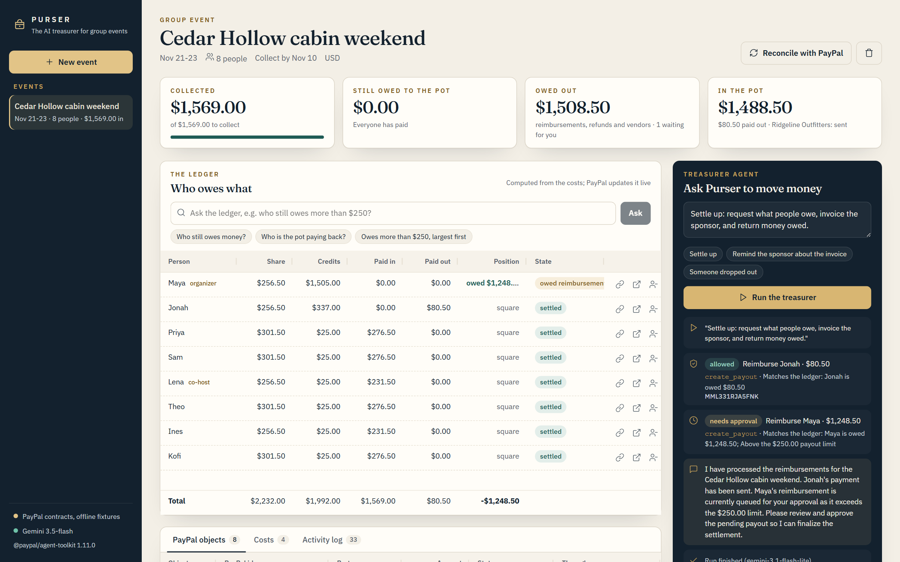

# Purser - the AI treasurer for group events

Someone always ends up being the treasurer of the group trip: fronting the cabin deposit,
chasing eight people for $276.50 each, paying the boat rental, refunding the friend who
dropped out. Purser is an agent that does that job through PayPal - and that the organizer
can actually trust with money, because every move it makes is checked against the ledger
before it reaches PayPal.

Built for the [PayPal AI Hackathon](https://paypalaihackathon.devpost.com/) (Oct-Nov 2026)
by Rui Codex. New code, written for this hackathon. MIT licence.

- **Demo video (2:23):** https://youtu.be/3e2EhTpMcA0
- **Try it (no-keys demo, reset nightly):** https://purser.ruicodex.com
- **Repository:** https://github.com/RuiCodex-dev/purser



## What it does

1. **Reads a plain-language brief** ("Cabin $1,480, Maya already paid it. Kayak tour $45 per
   person, optional: Priya, Sam, Theo, Kofi. Boat $260 from Lakeside Rentals...") into a
   ledger: people, costs, who fronted what, vendors and sponsors. Gemini reads it; every name
   it returns must appear in the brief, or the strict offline parser takes over.
2. **Computes exact positions** in integer cents: shares split to the cent, out-of-pocket
   costs and sponsor money netted out, optional extras only for those who opted in.
3. **Moves money through PayPal** with an agent that calls the **PayPal Agent Toolkit**:
   - `create_order` per person, with a personal pay link; capture on return (Orders v2,
     idempotent), confirmed by webhooks;
   - `create_invoice` + `send_invoice` (+ `send_invoice_reminder`) for sponsors;
   - **Payouts v1** to reimburse whoever fronted costs and to pay vendors;
   - `create_refund` on the original capture when someone drops out (only the refundable
     part of their share);
   - `list_transactions`, `get_order`, `get_invoice` for reconciliation.
4. **The mandate**: every money-moving tool call is normalised and checked in plain code
   before it reaches PayPal. An order must equal what the ledger says that person owes, to
   the cent; a payout or refund can only go to someone the ledger owes, never above what
   they are owed; money never leaves the pot before it has arrived; large payouts, large
   refunds and vendor payments wait in an approval inbox. Return URLs are pinned by Purser,
   not by the model. A denied call goes back to the model with the reason and the ledger's
   expected value, so it can correct itself.
5. **Reconciles**: PayPal webhooks (signature-verified with
   `verify-webhook-signature`), plus a pull-based reconcile for anything in flight. Pending
   approvals expire automatically when the ledger moves under them.
6. **Shows its work** in an AG Grid ledger the organizer can **question in plain English**
   ("who still owes more than $250, largest first" becomes a grid filter and sort), plus
   grids of every PayPal object and of the full audit log (actor, verdict, PayPal id,
   debug id).
7. **Reads receipts** (photo -> merchant and total -> a cost item) and drafts friendly
   payment reminders that always keep the exact amount and link.

## Run it (judges: this works with no keys at all)

Requirements: Node.js **22.18 or newer** (Purser runs TypeScript directly with Node's type
stripping; no build step for the server).

```sh
npm ci
npm run build      # builds the web app into web/dist
npm start          # http://localhost:8790
```

Open http://localhost:8790, click **New event**, then **Skip to the demo event** (or paste
your own brief), and press **Run the treasurer**. Open a participant's pay link from the
ledger to pay as them.

With no credentials Purser runs on **offline fixtures of the PayPal sandbox contracts**:
the same Orders v2 / Invoicing v2 / Payouts v1 / Refunds / webhook payloads the sandbox
returns (shapes taken from PayPal's API reference and from the Agent Toolkit's own
handlers, including its USD-only `create_order` schema), and a clearly labelled checkout
simulator in place of the PayPal approval page. Without a Gemini key the treasurer is the
deterministic ledger engine, run through the same mandate. The header of the app always
says which mode is live.

### With the real PayPal sandbox and Gemini

```sh
cp .env.example .env    # then fill in:
# PAYPAL_CLIENT_ID / PAYPAL_CLIENT_SECRET   sandbox app from developer.paypal.com
# PAYPAL_WEBHOOK_ID                          optional, enables webhook verification
# GEMINI_API_KEY                             a free Google AI Studio key is enough
npm start
```

Pay links then send participants to the real PayPal sandbox approval page; log in with a
sandbox personal account (Developer Dashboard > Testing Tools > Sandbox Accounts). For
webhooks, point a sandbox webhook at `https://<public-host>/api/webhooks/paypal` (any
tunnel works locally) and set `PUBLIC_BASE_URL` to the same host. Without webhooks,
**Reconcile with PayPal** pulls the same state.

`node scripts/sandbox-check.ts` exercises every PayPal surface Purser uses against the
sandbox and writes ids, statuses and debug ids (never secrets) to
`docs/sandbox-evidence/`. `node scripts/sandbox-check.ts --sdk` runs the Orders v2 drill
through the PayPal Server SDK: a EUR order with an idempotent replay, a read, a real
`INSTRUMENT_DECLINED` via PayPal's negative-testing header, and a revoked-token retry.

### PayPal libraries

- **PayPal Agent Toolkit** (`@paypal/agent-toolkit`): the tools the agent sees, and their
  execution (orders for USD events, invoices, refunds, transactions).
- **PayPal Server SDK** (`@paypal/paypal-server-sdk`, generated by
  [APIMatic](https://www.apimatic.io/)): every other Orders v2 call goes through its
  `OrdersController`: capture on the payer's return (with `PayPal-Request-Id`), order reads
  for reconciliation and before a refund, and order creation for non-USD events, which the
  toolkit's `create_order` does not accept. The SDK handles client-credentials OAuth; the
  adapter retries once with a fresh SDK client when PayPal rejects a token.
- **REST** for what neither covers: Payouts v1 and `verify-webhook-signature`.

### Docker

```sh
docker build -t purser .
docker run --rm -p 8790:8790 --env-file .env purser
```

## How it is built

```
server/
  domain/      money (integer cents), ledger, planner (deterministic), policy (the mandate)
  paypal/      port.ts (one interface), live.ts (@paypal/agent-toolkit, the PayPal Server SDK
               for Orders v2, REST for Payouts v1 and webhook verification),
               fixtures.ts (offline replay of the sandbox contracts + simulator)
  ai/          gemini.ts (REST, function calling), agent.ts (the treasurer loop),
               brief.ts (brief reader + grounding check), assist.ts (receipts, ask, reminders)
  treasury.ts  the guarded executor: normalise -> mandate -> PayPal -> ledger -> audit
  app.ts       HTTP API, SSE stream, participant pay pages, webhook endpoint
web/           React + AG Grid Community organizer app
test/          node:test suites (domain, end-to-end over HTTP, a scripted rogue model)
```

The model never touches money directly. It sees the **Agent Toolkit's own tool
definitions** (read from the installed `@paypal/agent-toolkit` at runtime and converted to
Gemini function declarations) plus two Purser tools (`create_payout`, `get_ledger`). Each
call goes through `Treasury.run`: normalise the arguments into a money action, evaluate the
mandate against a freshly computed ledger, then execute through the toolkit (live) or the
fixtures (offline), apply the PayPal response to the ledger and write an audit entry with
the PayPal id and debug id. Every tool result returns the ledger engine's remaining
`next_steps`, so the model always knows what is left.

Tests: `npm test` (27 tests, no network) - money and split invariants, the drop-out maths,
every mandate rule, the brief parser, grounding check and its repairs, a full fixture flow
over HTTP (pay link -> checkout simulator -> capture exactly once despite return URL and
webhook racing -> payout settled by webhook -> drop-out refund -> sponsor invoice paid ->
unsigned webhook refused), a scripted "rogue" model that tries to pay an attacker,
overcharge a guest and pay out money not yet collected (all three denied, nothing moved),
and the failure paths: two identical payouts at once (PayPal is called once), a double
click on a pay link (one order), a card declined at capture (the payer is sent back to
PayPal for the same order), a payer approving a replaced request (never captured), a
network failure (audited, nothing recorded), an expired OAuth token (refreshed once,
same PayPal-Request-Id), a refund whose answer was lost (read back from PayPal, never sent
twice) and a model that gets refundability wrong (corrected from the brief).

Live: `node scripts/live-e2e.ts` runs 28 checks against the real PayPal sandbox and Gemini
(orders through the Agent Toolkit matched to the ledger, the sponsor invoice sent and
reminded, the reminder cooldown, a pay link landing on PayPal's sandbox checkout, payouts
and the approval inbox, reconcile, transaction search, request-id idempotency, a sandbox
`INSTRUMENT_DECLINED`, token refresh). `--continue <event>` checks captures, idempotent
re-capture, the drop-out refund and that PayPal holds exactly the refunds the ledger booked,
once two pay links have been paid on PayPal's sandbox checkout (9 checks; passed 9/9 on
2026-10-16 with guest card payments). Evidence: `docs/sandbox-evidence/`.

## AI tools used

| Tool | Where | How |
| --- | --- | --- |
| **PayPal Agent Toolkit** (`@paypal/agent-toolkit` 1.11.0) | `server/paypal/live.ts`, `server/ai/agent.ts` | Tool schemas for the agent and execution of orders, invoices, refunds and transaction listing in the sandbox |
| **Google Gemini** (`gemini-3.5-flash`, falls back to `gemini-3.1-flash-lite`) via the Gemini API | `server/ai/*` | Function-calling treasurer agent; brief -> structured budget (JSON schema); receipt photo -> merchant and total (vision); question -> AG Grid filter model; payment reminders |
| **Google Flow (Nano Banana Pro)** | `design/` | The risograph illustrations on the home and new-event screens and in the video (logged in `design/GENERATED_ASSETS.md`) |
| **Claude Code** (Anthropic) | whole repo | Pair-programming assistant used to write and test the code and documents |

No AI-generated video or UI imagery: every screenshot and every UI shot in the demo video
is the running app.

## Limits, stated plainly

- Single organizer, no login: this is a hackathon build meant to run locally or behind a
  private URL. Participant pages are reachable only through unguessable per-person tokens.
- The Agent Toolkit's `create_order` accepts USD only; for other currencies Purser creates
  the same order through Orders v2 directly, through the same mandate.
- Payouts in the sandbox to an address without a sandbox account stay UNCLAIMED, as they
  would in production.
- Offline fixtures replay documented contracts; they are not PayPal. The mode is always
  shown, and `scripts/sandbox-check.ts` and `scripts/live-e2e.ts` are how the live sandbox
  is verified.
- A hosted demo is optional under the rules; the plan is in `docs/HOSTING_PLAN.md`.

## Credits

Fonts, icons and media licences: [CREDITS.md](CREDITS.md). Design system:
[design/STYLE_GUIDE.md](design/STYLE_GUIDE.md).
